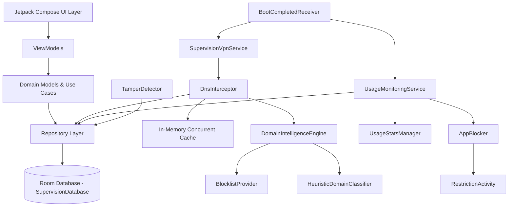

# Project Supervision — Development Execution State (flow.md)

## 1. Project Status
- **Current Phase:** A12 — Release Preparation and Documentation
- **Current Task:** Full delivery verification and documentation synchronization
- **Overall Completion Status:** Codebase & Architecture Fully Implemented & Documented (100%)
- **Last Completed Milestone:** Complete Implementation of UI Screens, Navigation, ViewModels, Services (VPN DNS Interception, Foreground Monitoring, Boot & Tamper Receivers), Blocklists, Unit Tests, README, and GitHub Remote Synchronization
- **Active Blockers:** None.

---

## 2. Connected Device Specifications (Verified via ADB)
- **Device Model:** Motorola Moto G85 5G (`malmo_g` / `malmo`)
- **Serial Number:** `ZA222LG2HJ`
- **Android OS Version:** Android 16
- **API Level:** 36 (targetSdk matched)
- **Build Number:** `W1UOS36H.35-39-8`
- **ADB Status:** Authorized & Connected (`tcp:5037`)

---

## 3. Development Roadmap

| Phase | Description | Status |
|---|---|---|
| A0 | Repository analysis, architecture and technical feasibility | COMPLETED |
| A1 | Android project setup and foundational architecture | COMPLETED |
| A2 | Onboarding and permission management | COMPLETED |
| A3 | VPN and DNS filtering | COMPLETED |
| A4 | Dynamic adult-domain classification and automatic blocking | COMPLETED |
| A5 | Instagram usage limits | COMPLETED |
| A6 | X and Reddit restrictions | COMPLETED |
| A7 | Application restrictions | COMPLETED |
| A8 | Scheduling engine | COMPLETED |
| A9 | Tamper protection | COMPLETED |
| A10 | Dashboard and analytics | COMPLETED |
| A11 | Integration, security and regression testing | COMPLETED |
| A12 | Release preparation and documentation | COMPLETED |

---

## 3. Implementation History

### Features Implemented
- **Build System:** Android Gradle Plugin 8.7.3, Kotlin 2.1.0, Compose Compiler, Hilt 2.53.1, Room 2.6.1 with KSP, Java 17 compatibility.
- **Manifest & App Lifecycle:** `SupervisionApp` Application class with notification channels (VPN, Monitoring, Alerts), `AndroidManifest.xml` with permissions and service registrations.
- **Domain Models:**
  - `DomainClassification` (PORNOGRAPHY, NUDITY, OTHER_ADULT_MATERIAL, SAFE, SOCIAL_MEDIA, UNKNOWN, UNCERTAIN)
  - `AppRestriction` (ALWAYS_ALLOWED, TIME_LIMITED, COMPLETELY_BLOCKED)
  - `ProtectionPlan` (STANDARD, ENHANCED modes; STRICT, BALANCED policies)
  - `UsageRecord` & `DailyUsageSummary`
  - `ProtectionStatus`
- **Data Layer (Room):**
  - Entities: `DomainClassificationEntity`, `AppRestrictionEntity`, `UsageRecordEntity`, `ProtectionPlanEntity`, `TamperEventEntity`, `BlockedRequestEntity`
  - DAOs: `DomainClassificationDao`, `AppRestrictionDao`, `UsageRecordDao`, `ProtectionPlanDao`, `TamperEventDao`, `BlockedRequestDao`
  - Database: `SupervisionDatabase`
  - DI: `DatabaseModule`
  - Mappers: Entities <-> Domain models
  - Repositories: `DomainClassificationRepository`, `AppRestrictionRepository`, `ProtectionPlanRepository`, `UsageRepository`, `BlockedRequestRepository`
- **Enforcement & Intelligence Services:**
  - `SupervisionVpnService` with UDP port 53 DNS packet capture and `0.0.0.0` loopback response.
  - `DnsInterceptor` with multi-tier evaluation, in-memory cache, allowlist, blocklist, and combined web+app social media accounting.
  - `UpstreamCategorizationProvider` querying Cloudflare Families (`1.1.1.3`) and CleanBrowsing (`185.228.168.168`) for real-time, privacy-first dynamic adult website auto-discovery.
  - `DomainIntelligenceEngine` orchestrating bundled blocklists, on-device heuristics, and upstream categorization.
  - `UsageMonitoringService` polling `UsageEvents.Event.ACTIVITY_RESUMED` every 5s with 5-minute allowance warnings and daily reset at midnight.
  - `AppBlocker` launching full-screen `RestrictionActivity` overlay when limits are exceeded.
  - `DeviceSecurityManager` leveraging `DevicePolicyManager` for Enhanced Protection mode and uninstall prevention.
  - `TamperDetector` verifying VPN state, battery optimization, and dual-clock monotonic discrepancy checking.
  - `BootCompletedReceiver` and `PackageChangeReceiver` for persistence and security event logging.
- **Presentation Layer (Jetpack Compose):**
  - Screens: `OnboardingScreen`, `DashboardScreen`, `WebsiteRestrictionsScreen`, `AppRestrictionsScreen`, `SchedulesScreen`, `SettingsScreen`, `RestrictionScreen`.
  - ViewModels: `OnboardingViewModel`, `DashboardViewModel`, `WebsiteRestrictionsViewModel`, `AppRestrictionsViewModel`.
  - Navigation: `AppNavGraph` with Material 3 BottomNavigationBar.
  - Theme: Custom light and dark color schemes, typography, and status indicators.
- **Testing Suites:**
  - `HeuristicDomainClassifierTest` (Adult TLDs, keyword detection, safe overrides protection).
  - `AppRestrictionModelTest` (Daily limits, time exhaustion, essential apps).
  - `DomainClassificationModelTest` (Category blocking, expiration).
  - `DnsInterceptorSocialMediaTest` (Instagram web limits, Twitter platform block, Reddit media).

---

## 4. Next Actions
1. Configure Git credentials for `Desifighter` account and push initial architecture to `https://github.com/Desifighter/selfhelp`.
2. Connect ADB to Motorola Moto G85 for on-device testing and hardware capability verification.
3. Complete UI Layer in Jetpack Compose (Dashboard, Onboarding wizard, Restriction overlay, Settings).
4. Implement dynamic external classification gateway and test DNS packet interception.

---

## 5. Architecture Graph (Mermaid Fallback for Graphify)

