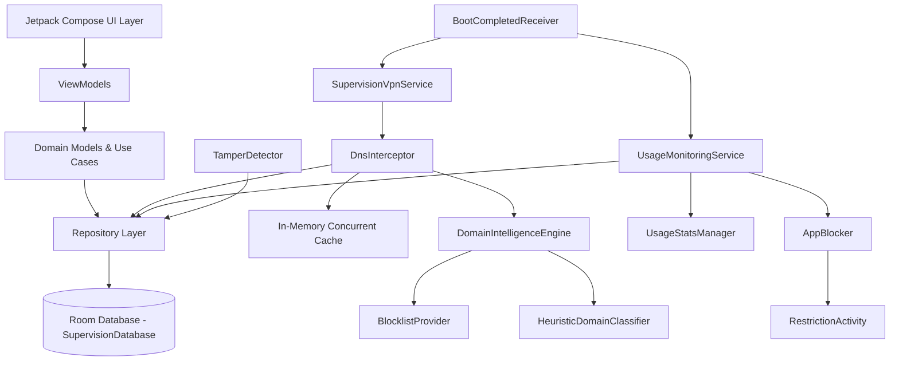

# Project Supervision — Development Execution State (flow.md)

## 1. Project Status
- **Current Phase:** A1 — Android Project Setup and Foundational Architecture
- **Current Task:** GitHub remote synchronization (`Desifighter/selfhelp`)
- **Overall Completion Status:** Foundational Architecture Established (~18%)
- **Last Completed Milestone:** Android Gradle build system, Room database schema, Domain entities & models, Repository layer, VPN & Monitoring service skeleton, Physical Device Verified
- **Active Blockers:** GitHub authentication credentials for target repository `Desifighter/selfhelp` (switching from `Madhav-025`).

---

## 2. Connected Device Specifications (Verified via ADB)
- **Device Model:** Motorola Moto G85 5G (`malmo_g` / `malmo`)
- **Serial Number:** `ZA222LG2HJ`
- **Android OS Version:** Android 16
- **API Level:** 36 (targetSdk matched)
- **Build Number:** `W1UOS36H.35-39-8`
- **ADB Status:** Authorized & Connected (`tcp:5037`)

---

## 2. Development Roadmap

| Phase | Description | Status |
|---|---|---|
| A0 | Repository analysis, architecture and technical feasibility | COMPLETED |
| A1 | Android project setup and foundational architecture | IN_PROGRESS |
| A2 | Onboarding and permission management | NOT_STARTED |
| A3 | VPN and DNS filtering | NOT_STARTED |
| A4 | Dynamic adult-domain classification and automatic blocking | NOT_STARTED |
| A5 | Instagram usage limits | NOT_STARTED |
| A6 | X and Reddit restrictions | NOT_STARTED |
| A7 | Application restrictions | NOT_STARTED |
| A8 | Scheduling engine | NOT_STARTED |
| A9 | Tamper protection | NOT_STARTED |
| A10 | Dashboard and analytics | NOT_STARTED |
| A11 | Integration, security and regression testing | NOT_STARTED |
| A12 | Release preparation and documentation | NOT_STARTED |

---

## 3. Implementation History

### Features Implemented
- **Build System:** Android Gradle Plugin 8.7.3, Kotlin 2.1.0, Compose Compiler, Hilt 2.53.1, Room 2.6.1 with KSP, Java 17 compatibility.
- **Manifest & App Lifecycle:** `SupervisionApp` Application class with notification channels (VPN, Monitoring, Alerts), `AndroidManifest.xml` with permissions and service registrations.
- **Domain Models:**
  - `DomainClassification` (PORNOGRAPHY, NUDITY, OTHER_ADULT_MATERIAL, SAFE, SOCIAL_MEDIA, UNKNOWN, UNCERTAIN)
  - `AppRestriction` (ALWAYS_ALLOWED, TIME_LIMITED, COMPLETELY_BLOCKED)
  - `ProtectionPlan` (STANDARD, ENHANCED modes; STRICT, BALANCED policies)
  - `UsageRecord` & `DailyUsageSummary`
  - `ProtectionStatus`
- **Data Layer (Room):**
  - Entities: `DomainClassificationEntity`, `AppRestrictionEntity`, `UsageRecordEntity`, `ProtectionPlanEntity`, `TamperEventEntity`, `BlockedRequestEntity`
  - DAOs: `DomainClassificationDao`, `AppRestrictionDao`, `UsageRecordDao`, `ProtectionPlanDao`, `TamperEventDao`, `BlockedRequestDao`
  - Database: `SupervisionDatabase`
  - DI: `DatabaseModule`
  - Mappers: Entities <-> Domain models
  - Repositories: `DomainClassificationRepository`, `AppRestrictionRepository`, `ProtectionPlanRepository`, `UsageRepository`, `BlockedRequestRepository`
- **Services (Skeleton):**
  - `SupervisionVpnService` with DNS packet interception and loopback response
  - `DnsInterceptor` with multi-tier evaluation
  - `DomainIntelligenceEngine` with heuristic classifier and blocklist provider
  - `UsageMonitoringService` using `UsageStatsManager`
  - `BootCompletedReceiver` for device restart persistence
  - `SupervisionDeviceAdminReceiver` for enhanced device protection
  - `TamperDetector` and `PackageChangeReceiver`

---

## 4. Next Actions
1. Configure Git credentials for `Desifighter` account and push initial architecture to `https://github.com/Desifighter/selfhelp`.
2. Connect ADB to Motorola Moto G85 for on-device testing and hardware capability verification.
3. Complete UI Layer in Jetpack Compose (Dashboard, Onboarding wizard, Restriction overlay, Settings).
4. Implement dynamic external classification gateway and test DNS packet interception.

---

## 5. Architecture Graph (Mermaid Fallback for Graphify)

